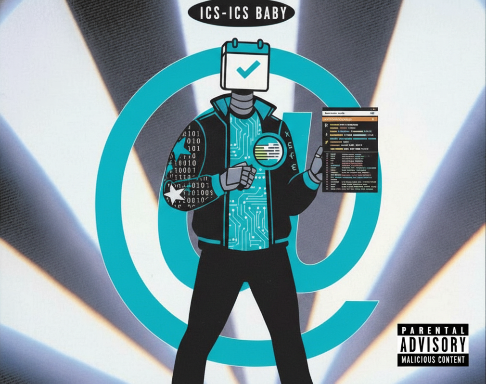

# ics-ics-baby [https://suno.com/s/KuqOpEIg8A2YG9VL](https://suno.com/s/NAsV8wMpu6sLKxH5) 


`ics-ics-baby` is a CLI workbench for tearing apart suspicious calendar invites. It parses `.ics` payloads, extracts everything useful (events, tasks, free/busy, attachments, vcards), and emits:

- a JSON manifest summarising the invite
- an HTML preview suitable for quick eyeballing (now including calendar branding, attendee badges, published availability, and inline image metadata)
- a PNG rendering for embedding into reports or tickets with matching colour accents and context chips
- any attachments referenced by the calendar item

Security-oriented heuristics drive the renderer: descriptions are normalised for readability, rich HTML is sanitised before display, and conference/URL metadata is preserved for downstream tooling.

## Features

- **Full RFC 5545 coverage**: events, todos, journals, free/busy, alarms, timezones, `X-*` vendor properties, and vCards.
- **Dual description handling**: both plain `DESCRIPTION` text and `X-ALT-DESC` HTML are captured and exposed as `description` / `description_html`.
- **Renderer parity**: HTML and PNG previews share sanitised content and now highlight attendee delegation metadata, calendar-defined colours, image assets, and availability windows alongside organisers, recurrence, attachments, and discovered URLs.
- **Attachment extraction**: inline base64 blobs (including vCards) and remote links are saved into the output directory.
- **URL harvesting**: every description/todo body is scanned for URLs and surfaced in the manifest.

> ⚠️ `--download-attachments` contacts remote hosts. Use it only on trusted networks and adjust `--max-attachment-bytes` (default 100 MiB) to keep per-file size in check. `--max-attachments N` caps how many attachments are saved or downloaded per calendar; failed attempts count too (default: unlimited).

## Installation

### Option 1: Pre-built Releases (Recommended)

Download the latest release for your platform from the releases page.

```bash
# Download the binary for your platform (Linux example)
# Make executable and run
chmod +x ics-ics-baby_linux_amd64
./ics-ics-baby_linux_amd64 suspect.ics
```

**Note:** Pre-built releases contain only the `ics-ics-baby` binary (statically linked, no dependencies). The `wkhtml-wrap` sandbox is **not included** in distribution packages because it has system-specific library dependencies. If you want to use the `wkhtml` screenshot engine, you'll need to build `wkhtml-wrap` locally (see Option 2 below).

### Option 2: Build from Source

#### Quick Install (Linux)

The easiest way to get started on Linux is to use the automated installer:

```bash
# Install all dependencies (Go, libseccomp, build tools)
./install-deps.sh

# Build and install locally to ~/.local/bin
./build.sh install
```

The `install-deps.sh` script will:
- Check if Go is installed, and install it if missing (with choice of latest official binary or distro package)
- Install libseccomp development libraries
- Install build essentials (gcc, pkg-config, etc.)
- Verify all installations

#### Manual Installation

If you prefer to install Go manually or are on macOS/Windows:

**Go Installation:**

**Linux (Debian/Ubuntu):**
```bash
# Option A: Using apt (may be older version)
sudo apt-get update
sudo apt-get install -y golang

# Option B: Install latest from official source
wget https://go.dev/dl/go1.25.4.linux-amd64.tar.gz
sudo rm -rf /usr/local/go
sudo tar -C /usr/local -xzf go1.25.4.linux-amd64.tar.gz
echo 'export PATH=$PATH:/usr/local/go/bin' >> ~/.bashrc
source ~/.bashrc
```

**macOS:**
```bash
# Using Homebrew
brew install go

# Or download from: https://go.dev/dl/
```

**Windows:**
Download and run the installer from https://go.dev/dl/

Verify installation:
```bash
go version  # Should show Go 1.22 or later
```

**Building:**

```bash
# Build distribution packages (main binary only)
./build.sh

# Or build and install locally (includes wkhtml-wrap on Linux)
./build.sh install

# Or install to custom directory
./build.sh install /usr/local

# Or build just the main binary
go build ./cmd/ics-ics-baby
```

#### Building wkhtml-wrap Sandbox (Linux Only)

The `wkhtml-wrap` sandbox uses CGO and has **system-specific dependencies**. It must be built on the target system:

```bash
# Install build dependencies (Debian/Ubuntu)
./install-deps.sh

# Or manually:
sudo apt-get update
sudo apt-get install -y libseccomp-dev gcc

# Build wkhtml-wrap
./build-wrapper.sh

# Install to user directory
install -d ~/.local/bin
install -m 755 ./wkhtml-wrap ~/.local/bin/

# Or install system-wide
sudo install -m 755 ./wkhtml-wrap /usr/local/bin/

# Runtime dependency (needed to run wkhtml-wrap)
sudo apt-get install -y libseccomp2
```

**Why build locally?** The `wkhtml-wrap` sandbox:
- Links against `libseccomp.so.2` (dynamic library)
- Requires matching system architecture (amd64/arm64)
- Needs kernel 5.13+ for Landlock (falls back gracefully on older kernels)
- Cannot be reliably cross-compiled or distributed pre-built

**Installing wkhtmltoimage:**

```bash
# Debian/Ubuntu
sudo apt-get install wkhtmltopdf

# Fedora/RHEL
sudo dnf install wkhtmltopdf

# macOS
brew install --cask wkhtmltopdf

# Or download from: https://wkhtmltopdf.org/downloads.html
```

## Quick Start

```bash
# Recommended: use wkhtml engine with sandbox (Linux)
./ics-ics-baby --screenshot-engine wkhtml suspect.ics

# Or use pure Go renderer (no dependencies)
./ics-ics-baby suspect.ics

# With all options
./ics-ics-baby \
  --out out/badinvite1 \
  --screenshot-engine wkhtml \
  --download-attachments \
  /path/to/suspect.ics
```

Outputs land in `out/` by default:

- `ics-ics-baby-manifest.json`
- `ics-ics-baby-preview.html`
- `ics-ics-baby-preview.png`
- `ics-ics-baby-attachments/…`

## Renderer Preview

- **HTML (`ics-ics-baby-preview.html`)** — system fonts, clickable links, sanitised HTML descriptions, attendee email annotations.
- **PNG (`ics-ics-baby-preview.png`)** — OCR-friendly rendering with embedded fonts, matching layout to the HTML version.

Both surfaces italicise suspicious data with bullets and chips, making it easy to scan alarm triggers, attachments, and conference joins.

### Screenshot Engines

Three rendering engines are available via `--screenshot-engine`:

**`go` (default)** — Pure Go renderer with embedded fonts (NotoSans, DejaVu). Lightweight, no external dependencies, renders description as plain text.

**`wkhtml`** — Uses `wkhtmltoimage` (Qt5 WebKit) to render the full HTML preview. Requires:
- `wkhtmltoimage` binary in PATH
- `wkhtml-wrap` sandbox (strongly recommended for security, must be built locally - see [Building wkhtml-wrap Sandbox](#building-wkhtml-wrap-sandbox-linux-only))

The `wkhtml` engine provides:
- Full HTML table rendering (invoice layouts, structured content)
- Better text rendering with system fonts
- Proper handling of complex HTML descriptions

**`chromium`** — Renders the HTML preview with headless Chromium (driven over CDP by chromedp; the release binary stays static). Chromium is a **runtime** requirement only when this engine or `--invite-view` is selected; a missing browser is a clear error and exit code 1. Each render:

- launches a fresh headless Chromium with a throwaway profile, killed on return or timeout
- disables JavaScript (`Emulation.setScriptExecutionDisabled` plus `blink-settings=scriptEnabled=false`)
- intercepts every request (`Fetch.enable`) and allows exactly one `file://` URL, the HTML being rendered, plus `data:` URLs. Everything else is failed, including other files in the output directory, and printed as `[chromium] blocked: <url>`
- uses a dead proxy (`127.0.0.1:9`, loopback included) and `host-resolver-rules=MAP * ~NOTFOUND`, so no request and no DNS lookup leaves the process
- captures the full page, with the capture height capped (default 20000 px)
- keeps the Chromium sandbox on unless `--chromium-no-sandbox` is given (only for containers that cannot provide it)

| Flag | Default | Meaning |
|------|---------|---------|
| `--chromium-bin PATH` | search PATH for `chromium`, `chromium-browser`, `google-chrome`, `headless_shell` | browser binary |
| `--chromium-timeout D` | `45s` | wall-clock limit per render |
| `--chromium-max-height N` | `20000` | capture height cap in pixels |
| `--chromium-no-sandbox` | off | disable the Chromium sandbox |

```bash
./ics-ics-baby --screenshot-engine chromium suspect.ics
```

**Security**: When using `wkhtml` engine, the `wkhtml-wrap` sandbox is **strongly recommended**. It provides defense-in-depth isolation for `wkhtmltoimage`:

**Filesystem Isolation:**
- **Landlock V5**: Write access only to output directory and isolated temp directory
- Blocks path traversal and symlink attacks
- Read-only access to system libraries and fonts

**Process Isolation:**
- **seccomp-bpf**: Blocks 30+ dangerous syscalls (fork, network, mount, ptrace, etc.)
- Prevents process spawning, network access, and privilege escalation
- `PR_SET_NO_NEW_PRIVS`: Blocks setuid/setgid escalation

**Resource Limits:**
- CPU: 60 seconds maximum
- Memory: 2GB address space
- File size: 100MB maximum
- File descriptors: 512 maximum

**Additional Hardening:**
- umask 0077 (restrictive file permissions)
- Disabled core dumps
- Isolated per-execution temp directory

The wrapper is auto-discovered from:
1. `--wkhtml-wrap` flag (if specified)
2. Same directory as `ics-ics-baby` binary
3. System PATH

If `--wkhtml-wrap` is explicitly specified but not found, execution fails. Otherwise, it falls back to direct execution with a warning.

Example with wkhtml engine:
```bash
./ics-ics-baby --screenshot-engine wkhtml suspect.ics
# [wkhtml] Using sandboxed wrapper: /path/to/wkhtml-wrap
```

Without sandbox (warning issued):
```bash
./ics-ics-baby --screenshot-engine wkhtml --wkhtml-wrap "" suspect.ics
# [wkhtml] WARNING: Running wkhtmltoimage without sandbox
```

## Outlook-web invite view (`--invite-view owa`)

The preview is an analyst card. `--invite-view owa` also writes an **emulation** of how Outlook on the web shows the meeting request, the view most Microsoft 365 recipients get. It is unbranded (no logos) and its footer reads "Emulated Outlook-on-the-web rendering — ics-ics-baby" with the input's sha256. **Treat it as an emulation, unverified until probed**: the body sanitizer's rules model known OWA behaviour but have not been measured against real OWA yet (see `internal/clientview/testdata/owa-probes/README.md`).

It is off by default and works fully offline. The view shows:

- subject, organizer, time, recurrence and location (a URL location becomes a link with its host)
- an inert RSVP bar (Accept, Tentative, Decline, Propose new time)
- a Join button when a meeting URL is present (`X-MICROSOFT-SKYPETEAMSMEETINGURL`, then `X-MICROSOFT-ONLINEMEETINGCONFLINK`, then `CONFERENCE`), labeled with the real target host. A non-http(s) join URL is shown as inert text.
- required and optional attendees, and an inert attachment list
- the body: the **raw** `X-ALT-DESC` when its `FMTTYPE` is HTML, sanitized OWA-style; otherwise the description as preformatted text

Remote images, CSS `url()`, relative, `file:` and `cid:` references are replaced by visible placeholders such as "remote image: host", and are never fetched. Scripts, frames, forms, event handlers and `javascript:` URLs are removed.

| METHOD | View |
|--------|------|
| REQUEST, PUBLISH, none | meeting request (first VEVENT; other events listed) |
| CANCEL | "Canceled:" subject and a cancellation banner |
| REPLY, COUNTER, DECLINECOUNTER, REFRESH, ADD, or no VEVENT | no view; the sidecar says `skipped` and why |

Outputs, written after the preview outputs:

- `ics-ics-baby-owa.html`: the view
- `ics-ics-baby-owa.png`: the view rendered with the `chromium` engine and the same isolation (absent when skipped or failed)
- `ics-ics-baby-owa.json`: the sidecar, with `profile`, `emulation: true`, `status` (`ok`, `skipped` or `render_failed`), `reason`, `error`, `input_sha256`, `event_uid`, `other_events`, `other_event_details` (join URL, remote refs and links of the events the view does not render), `join_url`, `remote_refs` (each with a `kind` of `remote`, `local`, `cid` or `inline_data`), `links`, `dropped` and `blocked_requests`
- `ics-ics-baby-inline/<sha256>.<ext>`: `data:` images from the body, at most 2 MiB each

An OWA failure never removes the preview outputs. The exit code is 1 when a requested render failed and 0 otherwise. A `skipped` view counts as success.

ics-ics-baby computes no perceptual hashes. It returns every image as a file (preview PNG, OWA PNG, extracted attachments and inline images) for a downstream pipeline to hash.

## Structured findings (`--findings-json`)

`--findings-json` writes `ics-ics-baby-findings.json`:

```json
{ "schema_version": "ics-ics-baby-findings/1", "input_sha256": "…",
  "findings": [ { "code": "teams_url_hijack", "severity": "high", "event_uid": "…",
                  "message": "…", "evidence": { "url": "…" } } ] }
```

Each alert in the manifest gets a stable `code`, kept in a single table in `internal/icsparse/findings.go`. Its `message` is the exact alert string, so the manifest and HTML do not change. `severity` is one of `info`, `low`, `medium` or `high`. Calendar-level findings have no `event_uid`.

## Blastbox engine

An optional blastbox engine named `ics-ics-baby` wraps this CLI. It lives with the other mail engines, in `src/mail_engines/icsbaby.py` of the msg-mbox-to-eml engines repo, together with its output contract (`blastbox-engine.ics-ics-baby.toml`). The engine pins a commit of this repo and runs the binary offline with `--screenshot-engine chromium --invite-view owa --findings-json --max-attachments N`. `--list-finding-codes` prints the finding code table as JSON, and the engine's tests check the contract's detections against it. The CLI itself has no blastbox dependency.

## Testing

### Unit Tests

```bash
GOCACHE=$(pwd)/.gocache go test ./...
```

Tests cover the parser (including description sanitisation) and ensure new fields hit the manifest.

### Security Test Suite

The `wkhtml-wrap` sandbox includes a comprehensive security test suite:

```bash
# Run wrapper security tests
cd cmd/wkhtml-wrap
./security_test.sh

# Or specify wrapper path
WRAPPER=/path/to/wkhtml-wrap ./security_test.sh
```

Tests validate:
- Path traversal prevention
- Sensitive file access blocking
- Network isolation
- Symlink attack prevention
- Resource exhaustion limits
- Command injection protection
- Process spawning restrictions

### Regenerating Test Outputs

Before packaging, regenerate outputs for any fixture invites with:

```bash
for f in /path/to/invites/*.ics; do
  name=$(basename "$f" .ics)
  GOCACHE=$(pwd)/.gocache go run ./cmd/ics-ics-baby \
    --out "out/$name" \
    --html "out/$name/ics-ics-baby-preview.html" \
    --screenshot "out/$name/ics-ics-baby-preview.png" \
    --download-attachments "$f"
done
```

## Project Layout

- `cmd/ics-ics-baby/` — CLI entrypoint (flag parsing, orchestrating outputs).
- `cmd/wkhtml-wrap/` — Landlock+seccomp sandbox wrapper for wkhtmltoimage (Linux only).
- `internal/icsparse/` — calendar/vcard parser, sanitisation, manifest builder.
- `internal/render/` — PNG renderers (Go native, wkhtmltoimage and headless Chromium).
- `internal/clientview/` — emulated client views (`owa`) and the OWA-style body sanitizer.
- `internal/webview/` — HTML rendering templates.
- `internal/attach/` — attachment detection and extraction utilities.
- `internal/fonts/` — embedded font files (NotoSans, DejaVu) for Go renderer.
- `internal/util/` — helpers for slugging, IO, etc.

`dist/` holds cross-platform binaries produced by `./build.sh`. Each run drops artifacts like:

- `ics-ics-baby_linux_amd64`
- `ics-ics-baby_linux_arm64`
- `ics-ics-baby_darwin_amd64`
- `ics-ics-baby_darwin_arm64`
- `ics-ics-baby_windows_amd64.exe`
- `ics-ics-baby_windows_arm64.exe`

All binaries are statically linked with no runtime dependencies (Chromium is needed at runtime only for `--screenshot-engine chromium` or `--invite-view`). The `wkhtml-wrap` sandbox is **not included** in distribution packages and must be built locally on the target system (see [Building wkhtml-wrap Sandbox](#building-wkhtml-wrap-sandbox-linux-only)). The `out/` directory is safe to purge between local runs.
